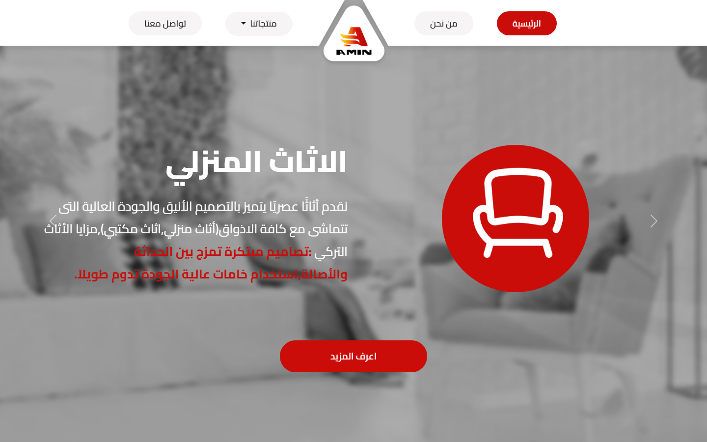

# AMIN — Al-Amin Foreign Trade Website

⚠️ This template was originally created by Mohammed Sabry
credit is required: github.com/Mohammedsabry13

A fully Arabic RTL corporate website for **شركة الأمين للتجارة الخارجية**, a Turkish products import/export company serving the Gulf Arab countries and North Africa under the "Rock" brand.

## 🛠️ Tech Stack

- **HTML5 & CSS5** — semantic RTL multi-page structure
- **Bootstrap 5 RTL** — full right-to-left responsive layout
- **WOW.js + Animate.css** — scroll-triggered entrance animations
- **Owl Carousel** — testimonials/partners carousel
- **Font Awesome** — icon set
- **Cairo** — Google Fonts Arabic typography
- **Vanilla JavaScript** — WOW.js init, Bootstrap components

## 📄 Pages

- `index.html` — Home
- `about-us.html` — About the company
- `tools.html` — Auto spare parts
- `asas.html` — Home furniture
- `mafroshat.html` — Textiles & bedding
- `bnaa.html` — Construction materials
- `contact-us.html` — Contact page

## ✨ Features

- **5-slide hero carousel** — each slide dedicated to one product category (Brand intro, Auto Parts, Furniture, Textiles, Construction) with WOW.js fadeIn animations per slide
- **Dual navbar** — dedicated Bootstrap mobile nav + separate custom desktop header layout
- **About section** — Vision, Mission & Values cards with heartbeat icon animations
- **Services section** — Product selection, Logistics, and Business consulting
- **Products section** — 4 category cards (Auto Parts, Furniture, Textiles, Construction Materials)
- **Owl Carousel** — client testimonials or partners slider
- **Multi-page product detail pages** — dedicated page per category with product listings
- **Scroll-reveal animations** — WOW.js fadeInRight, fadeInLeft, fadeInUp throughout
- **Full RTL layout** — Bootstrap 5 RTL + Arabic Cairo font throughout
- Fully responsive across all screen sizes
